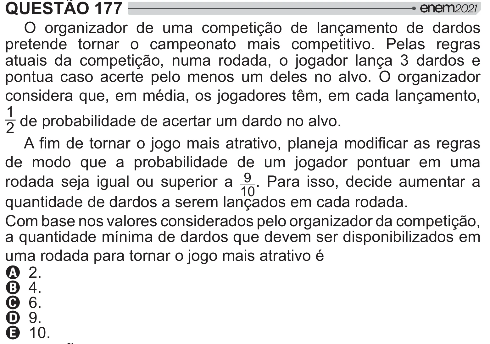

Texto extraído (pode conter ruído)

QUESTÃO 177  
O organizador de uma competição de lançamento de dardos  
pretende tornar o campeonato mais competitivo. Pelas regras  
atuais da competição, numa rodada, o jogador lança 3 dardos e  
pontua caso acerte pelo menos um deles no alvo. O organizador  
considera que, em média, os jogadores têm, em cada lançamento,  
1  
2 de probabilidade de acertar um dardo no alvo.  
  ‡   "# ‡     
de modo que a probabilidade de um jogador pontuar em uma  
rodada seja igual ou superior a 9 . Para isso, decide aumentar a  
10  
quantidade de dardos a serem lançados em cada rodada.  
Com base nos valores considerados pelo organizador da competição,  
a quantidade mínima de dardos que devem ser disponibilizados em  
uma rodada para tornar o jogo mais atrativo é  
A 2.  
B 4.  
C 6.  
D 9.  
E 10.

