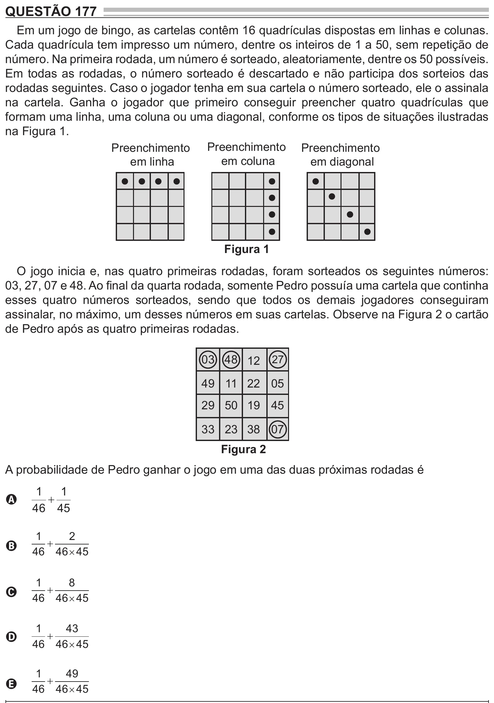

Texto extraído (pode conter ruído)

QUESTÃO 177  
Em um jogo de bingo, as cartelas contêm 16 quadrículas dispostas em linhas e colunas.  
Cada quadrícula tem impresso um número, dentre os inteiros de 1 a 50, sem repetição de  
número. Na primeira rodada, um número é sorteado, aleatoriamente, dentre os 50 possíveis.  
Em todas as rodadas, o número sorteado é descartado e não participa dos sorteios das  
rodadas seguintes. Caso o jogador tenha em sua cartela o número sorteado, ele o assinala  
na cartela. Ganha o jogador que primeiro conseguir preencher quatro quadrículas que  
formam uma linha, uma coluna ou uma diagonal, conforme os tipos de situações ilustradas  
na Figura 1.  
Preenchimento Preenchimento Preenchimento  
em linha  
em coluna  
em diagonal  
Figura 1  
O jogo inicia e, nas quatro primeiras rodadas, foram sorteados os seguintes números:  
03, 27, 07 e 48. Ao final da quarta rodada, somente Pedro possuía uma cartela que continha  
esses quatro números sorteados, sendo que todos os demais jogadores conseguiram  
assinalar, no máximo, um desses números em suas cartelas. Observe na Figura 2 o cartão  
de Pedro após as quatro primeiras rodadas.  
03 48 12 27  
49 11 22 05  
29 50 19 45  
33 23 38 07  
Figura 2  
A probabilidade de Pedro ganhar o jogo em uma das duas próximas rodadas é  
1  
1  
+  
A  
46 45  
1  
2  
  
B  
46 46  45  
1  
8  
  
C  
46 46  45  
1  
43  
  
D  
46 46  45  
1  
49  
  
E  
46 46  45

