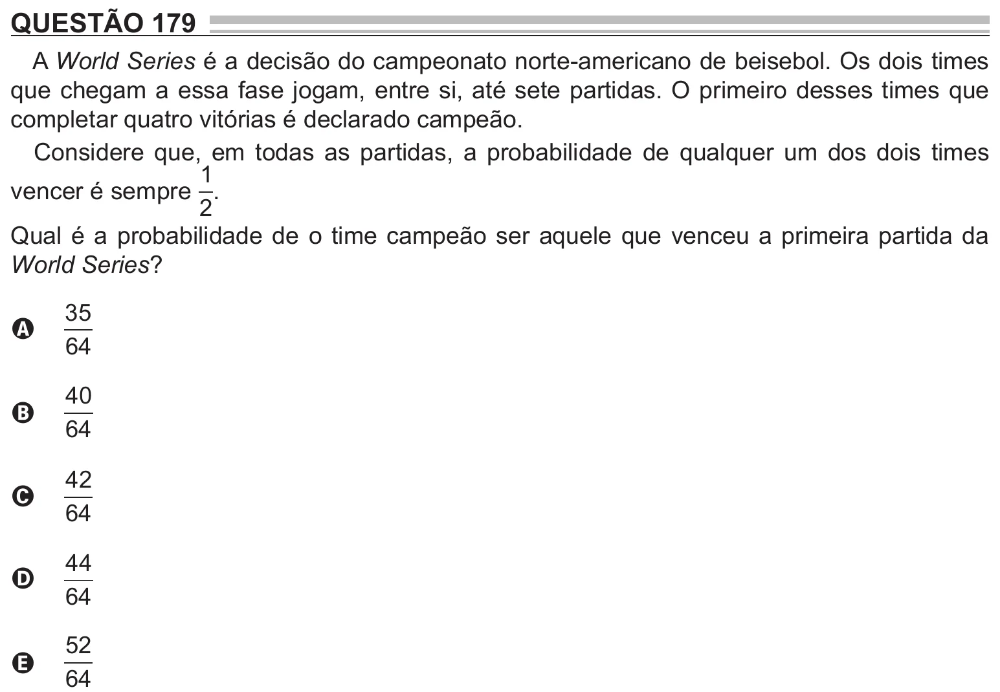

Texto extraído (pode conter ruído)

QUESTÃO 179  
A World Series é a decisão do campeonato norte-americano de beisebol. Os dois times  
que chegam a essa fase jogam, entre si, até sete partidas. O primeiro desses times que  
completar quatro vitórias é declarado campeão.  
Considere que, em todas as partidas, a probabilidade de qualquer um dos dois times  
1  
vencer é sempre .  
2  
Qual é a probabilidade de o time campeão ser aquele que venceu a primeira partida da  
World Series?  
35  
A  
64  
40  
B  
64  
42  
C  
64  
44  
D  
64  
52  
E  
64

