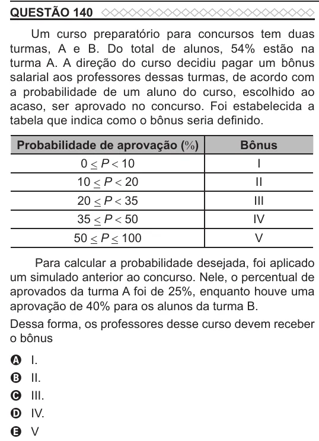

Texto extraído (pode conter ruído)

QUESTÃO 140  
Um curso preparatório para concursos tem duas  
turmas, A e B. Do total de alunos, 54% estão na  
turma A. A direção do curso decidiu pagar um bônus  
salarial aos professores dessas turmas, de acordo com  
a probabilidade de um aluno do curso, escolhido ao  
acaso, ser aprovado no concurso. Foi estabelecida a  
tabela que indica como o bônus seria definido.  
Probabilidade de aprovação (%)  
Bônus  
0 < P < 10  
I  
10 < P < 20  
II  
20 < P < 35  
III  
35 < P < 50  
IV  
50 < P < 100  
V  
Para calcular a probabilidade desejada, foi aplicado  
um simulado anterior ao concurso. Nele, o percentual de  
aprovados da turma A foi de 25%, enquanto houve uma  
aprovação de 40% para os alunos da turma B.  
Dessa forma, os professores desse curso devem receber  
o bônus  
A  
I.  
II.  
B  
III.  
C  
IV.  
D  
V  
E

