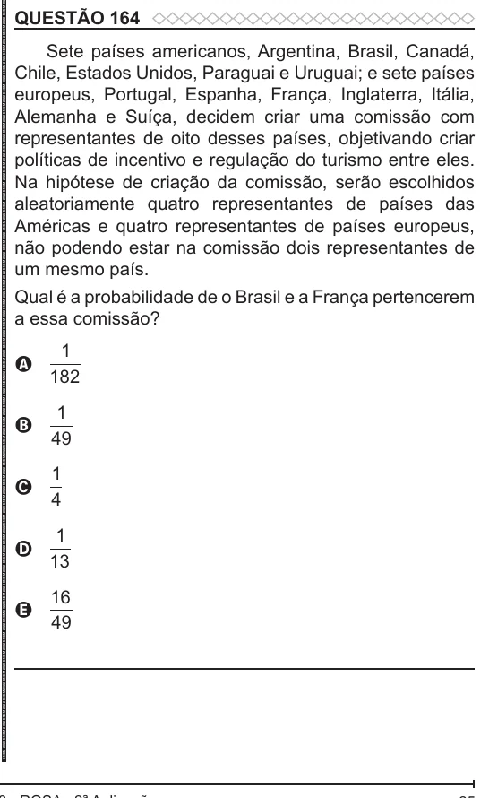

Texto extraído (pode conter ruído)

QUESTÃO 164  
Sete países americanos, Argentina, Brasil, Canadá,  
Chile, Estados Unidos, Paraguai e Uruguai; e sete países  
europeus, Portugal, Espanha, França, Inglaterra, Itália,  
Alemanha e Suíça, decidem criar uma comissão com  
representantes de oito desses países, objetivando criar  
políticas de incentivo e regulação do turismo entre eles.  
Na hipótese de criação da comissão, serão escolhidos  
aleatoriamente quatro representantes de países das  
Américas e quatro representantes de países europeus,  
não podendo estar na comissão dois representantes de  
um mesmo país.  
Qual é a probabilidade de o Brasil e a França pertencerem  
a essa comissão?  
1  
A  
182  
1  
B  
49  
1  
C  
4  
1  
D  
13  
16  
E  
49

