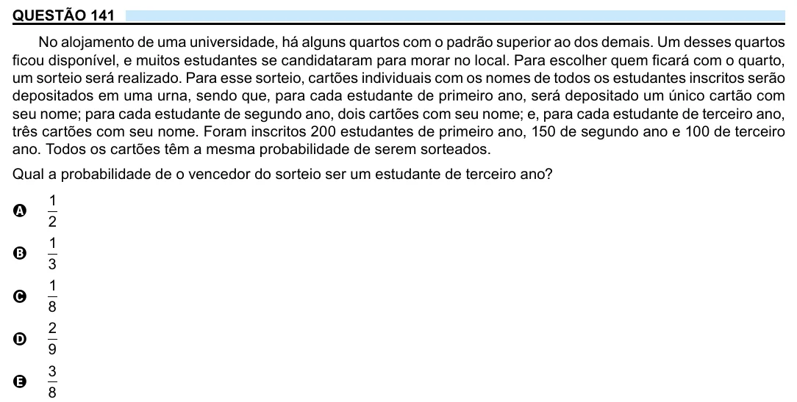

Texto extraído (pode conter ruído)

QUESTÃO 141  
No alojamento de uma universidade, há alguns quartos com o padrão superior ao dos demais. Um desses quartos  
ficou disponível, e muitos estudantes se candidataram para morar no local. Para escolher quem ficará com o quarto,  
um sorteio será realizado. Para esse sorteio, cartões individuais com os nomes de todos os estudantes inscritos serão  
depositados em uma urna, sendo que, para cada estudante de primeiro ano, será depositado um único cartão com  
seu nome; para cada estudante de segundo ano, dois cartões com seu nome; e, para cada estudante de terceiro ano,  
três cartões com seu nome. Foram inscritos 200 estudantes de primeiro ano, 150 de segundo ano e 100 de terceiro  
ano. Todos os cartões têm a mesma probabilidade de serem sorteados.  
Qual a probabilidade de o vencedor do sorteio ser um estudante de terceiro ano?  
1  
A  
2  
1  
B  
3  
1  
C  
8  
2  
D  
9  
3  
E  
8

