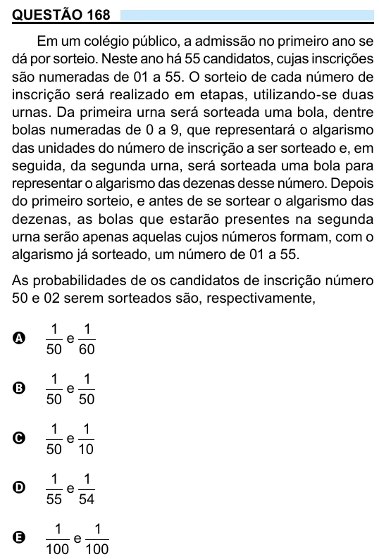

Texto extraído (pode conter ruído)

QUESTÃO 168  
Em um colégio público, a admissão no primeiro ano se  
dá por sorteio. Neste ano há 55 candidatos, cujas inscrições  
são numeradas de 01 a 55. O sorteio de cada número de  
inscrição será realizado em etapas, utilizando-se duas  
urnas. Da primeira urna será sorteada uma bola, dentre  
bolas numeradas de 0 a 9, que representará o algarismo  
das unidades do número de inscrição a ser sorteado e, em  
seguida, da segunda urna, será sorteada uma bola para  
representar o algarismo das dezenas desse número. Depois  
do primeiro sorteio, e antes de se sortear o algarismo das  
dezenas, as bolas que estarão presentes na segunda  
urna serão apenas aquelas cujos números formam, com o  
algarismo já sorteado, um número de 01 a 55.  
As probabilidades de os candidatos de inscrição número  
50 e 02 serem sorteados são, respectivamente,  
1  
1  
e  
A  
50 60  
1  
1  
e  
B  
50 50  
1  
1  
e  
C  
50 10  
1  
1  
e  
D  
55 54  
1  
1  
e  
E  
100 100

