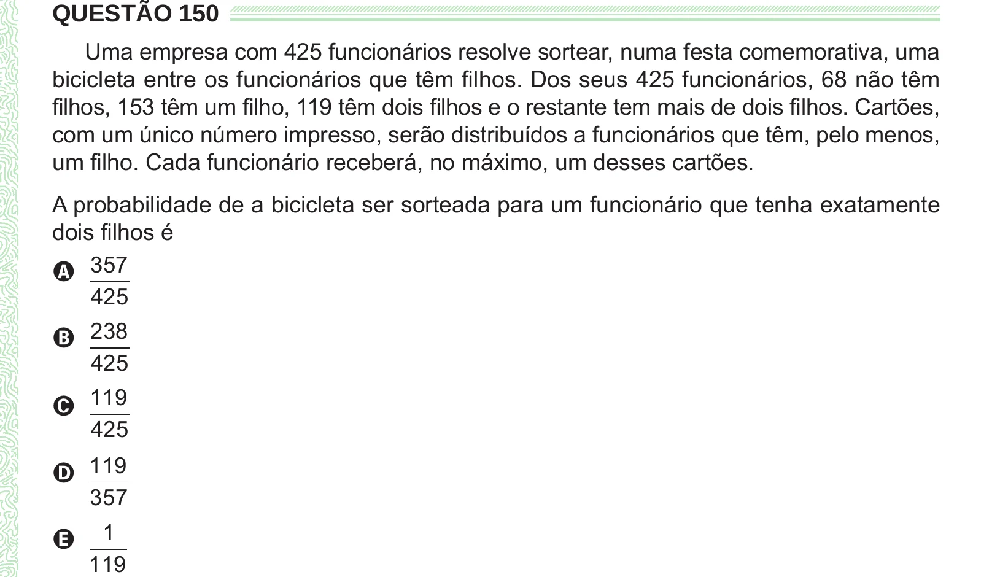

Texto extraído (pode conter ruído)

QUESTÃO 150  
Uma empresa com 425 funcionários resolve sortear, numa festa comemorativa, uma  
bicicleta entre os funcionários que têm filhos. Dos seus 425 funcionários, 68 não têm  
filhos, 153 têm um filho, 119 têm dois filhos e o restante tem mais de dois filhos. Cartões,  
com um único número impresso, serão distribuídos a funcionários que têm, pelo menos,  
um filho. Cada funcionário receberá, no máximo, um desses cartões.  
A probabilidade de a bicicleta ser sorteada para um funcionário que tenha exatamente  
dois filhos é  
A 357  
425  
B 238  
425  
C 119  
425  
D 119  
357  
1  
E  
119

