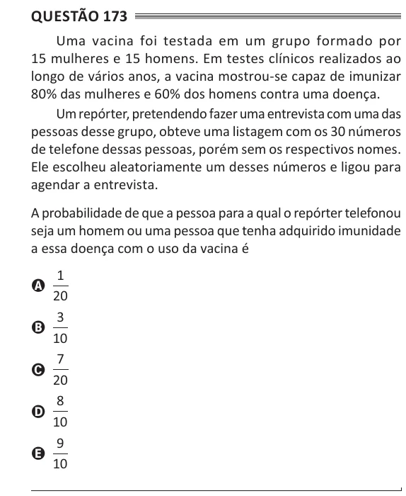

Texto extraído (pode conter ruído)

Questão 173  
Uma vacina foi testada em um grupo formado por  
15 mulheres e 15 homens. Em testes clínicos realizados ao  
longo de vários anos, a vacina mostrou-se capaz de imunizar  
80% das mulheres e 60% dos homens contra uma doença.  
Um repórter, pretendendo fazer uma entrevista com uma das  
pessoas desse grupo, obteve uma listagem com os 30 números  
de telefone dessas pessoas, porém sem os respectivos nomes.  
Ele escolheu aleatoriamente um desses números e ligou para  
agendar a entrevista.  
A probabilidade de que a pessoa para a qual o repórter telefonou  
seja um homem ou uma pessoa que tenha adquirido imunidade  
a essa doença com o uso da vacina é  
1  
A  
20  
3  
B  
10  
7  
C  
20  
8  
D  
10  
9  
E  
10

