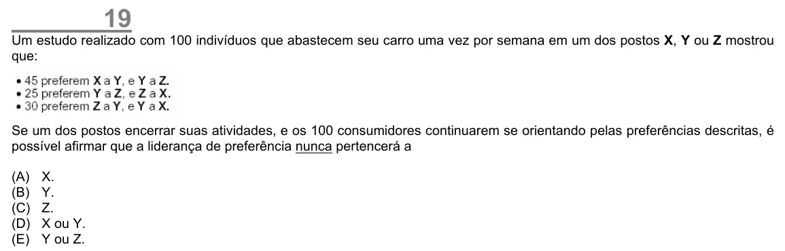

Texto extraído (pode conter ruído)

19  
Um estudo realizado com 100 indivíduos que abastecem seu carro uma vez por semana em um dos postos X, Y ou Z mostrou  
que:  
Se um dos postos encerrar suas atividades, e os 100 consumidores continuarem se orientando pelas preferências descritas, é  
possível afirmar que a liderança de preferência nunca pertencerá a  
(A)  
X.  
(B)  
Y.  
(C)  
Z.  
(D)  
X ou Y.  
(E)  
Y ou Z.

