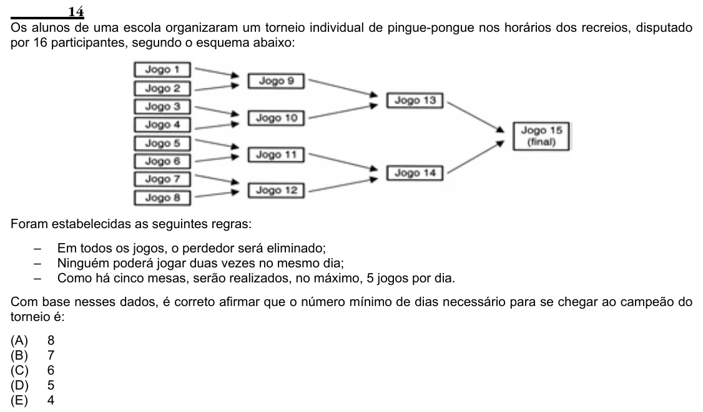

Texto extraído (pode conter ruído)

14  
Os alunos de uma escola organizaram um torneio individual de pingue-pongue nos horários dos recreios, disputado  
por 16 participantes, segundo o esquema abaixo:  
Foram estabelecidas as seguintes regras:  
–  
Em todos os jogos, o perdedor será eliminado;  
–  
Ninguém poderá jogar duas vezes no mesmo dia;  
–  
Como há cinco mesas, serão realizados, no máximo, 5 jogos por dia.  
Com base nesses dados, é correto afirmar que o número mínimo de dias necessário para se chegar ao campeão do  
torneio é:  
(A)  
8  
(B)  
7  
(C)  
6  
(D)  
5  
(E)  
4

