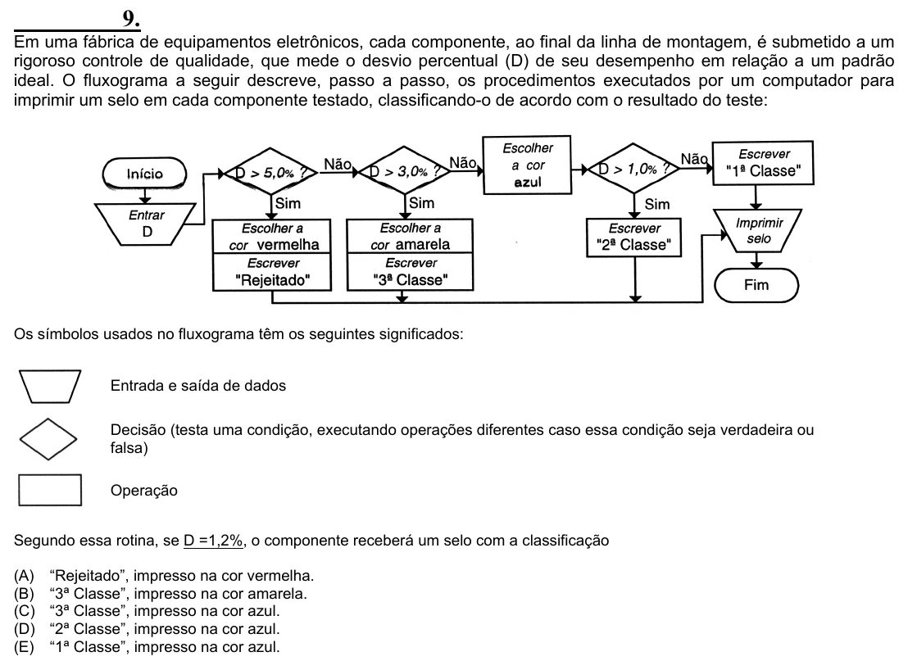

Texto extraído (pode conter ruído)

9.  
Em uma fábrica de equipamentos eletrônicos, cada componente, ao final da linha de montagem, é submetido a um  
rigoroso controle de qualidade, que mede o desvio percentual (D) de seu desempenho em relação a um padrão  
ideal. O fluxograma a seguir descreve, passo a passo, os procedimentos executados por um computador para  
imprimir um selo em cada componente testado, classificando-o de acordo com o resultado do teste:  
Os símbolos usados no fluxograma têm os seguintes significados:  
Entrada e saída de dados  
Decisão (testa uma condição, executando operações diferentes caso essa condição seja verdadeira ou  
falsa)  
Operação  
Segundo essa rotina, se D =1,2%, o componente receberá um selo com a classificação  
(A)  
“Rejeitado”, impresso na cor vermelha.  
(B)  
“3ª Classe”, impresso na cor amarela.  
(C)  
“3ª Classe”, impresso na cor azul.  
(D)  
“2ª Classe”, impresso na cor azul.  
(E)  
“1ª Classe”, impresso na cor azul.

