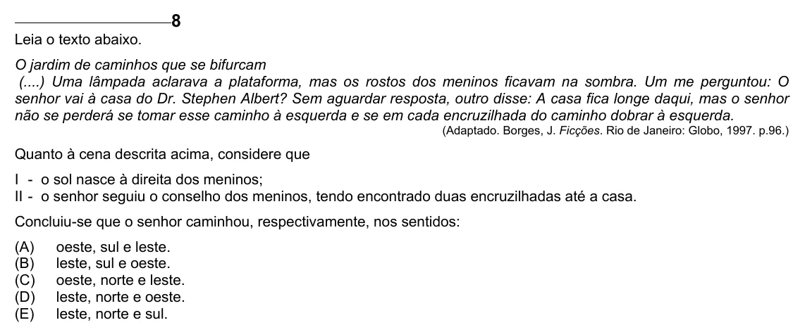

Texto extraído (pode conter ruído)

8  
Leia o texto abaixo.  
O jardim de caminhos que se bifurcam  
(....) Uma lâmpada aclarava a plataforma, mas os rostos dos meninos ficavam na sombra. Um me perguntou: O  
senhor vai à casa do Dr. Stephen Albert? Sem aguardar resposta, outro disse: A casa fica longe daqui, mas o senhor  
não se perderá se tomar esse caminho à esquerda e se em cada encruzilhada do caminho dobrar à esquerda.  
(Adaptado. Borges, J. Ficções. Rio de Janeiro: Globo, 1997. p.96.)  
Quanto à cena descrita acima, considere que  
I - o sol nasce à direita dos meninos;  
II - o senhor seguiu o conselho dos meninos, tendo encontrado duas encruzilhadas até a casa.  
Concluiu-se que o senhor caminhou, respectivamente, nos sentidos:  
(A)  
oeste, sul e leste.  
(B)  
leste, sul e oeste.  
(C)  
oeste, norte e leste.  
(D)  
leste, norte e oeste.  
(E)  
leste, norte e sul.

