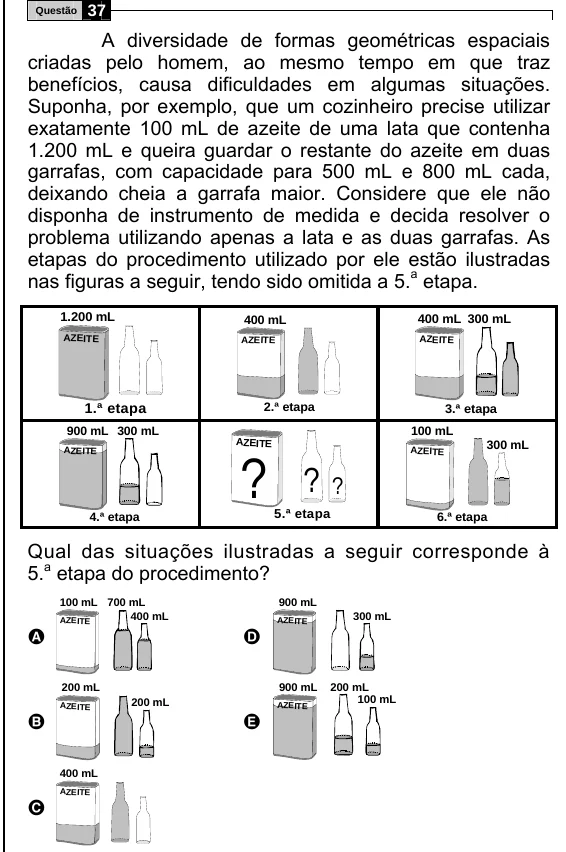

Texto extraído (pode conter ruído)

Questão  
37  
A diversidade de formas geométricas espaciais  
criadas pelo homem, ao mesmo tempo em que traz  
benefícios, causa dificuldades em algumas situações.  
Suponha, por exemplo, que um cozinheiro precise utilizar  
exatamente 100 mL de azeite de uma lata que contenha  
1.200 mL e queira guardar o restante do azeite em duas  
garrafas, com capacidade para 500 mL e 800 mL cada,  
deixando cheia a garrafa maior. Considere que ele não  
disponha de instrumento de medida e decida resolver o  
problema utilizando apenas a lata e as duas garrafas. As  
etapas do procedimento utilizado por ele estão ilustradas  
nas figuras a seguir, tendo sido omitida a 5. a etapa.  
1.200 mL  
400 mL  
400 mL 300 mL  
AZEITE  
AZEITE  
AZEITE  
1.ª etapa  
2.ª etapa  
3.ª etapa  
900 mL 300 mL  
100 mL  
AZEITE  
300 mL  
AZE ITE  
? ? ?  
AZEITE  
5.ª etapa  
4.ª etapa  
6.ª etapa  
Qual das situações ilustradas a seguir corresponde à  
5. a etapa do procedimento?  
100 mL 700 mL  
900 mL  
400 mL  
300 mL  
AZEITE  
AZE ITE  
A  
D  
200 mL  
900 mL  
200 mL  
100 mL  
AZE ITE  
200 mL  
AZEITE  
B  
E  
400 mL  
AZE ITE  
C

