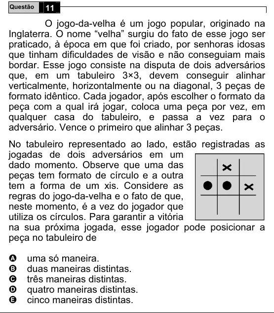

Texto extraído (pode conter ruído)

Questão  
11  
O jogo-da-velha é um jogo popular, originado na  
Inglaterra. O nome “velha” surgiu do fato de esse jogo ser  
praticado, à época em que foi criado, por senhoras idosas  
que tinham dificuldades de visão e não conseguiam mais  
bordar. Esse jogo consiste na disputa de dois adversários  
que, em um tabuleiro 3×3, devem conseguir alinhar  
verticalmente, horizontalmente ou na diagonal, 3 peças de  
formato idêntico. Cada jogador, após escolher o formato da  
peça com a qual irá jogar, coloca uma peça por vez, em  
qualquer casa do tabuleiro, e passa a vez para o  
adversário. Vence o primeiro que alinhar 3 peças.  
No tabuleiro representado ao lado, estão registradas as  
jogadas de dois adversários em um  
dado momento. Observe que uma das  
peças tem formato de círculo e a outra  
tem a forma de um xis. Considere as  
regras do jogo-da-velha e o fato de que,  
neste momento, é a vez do jogador que  
utiliza os círculos. Para garantir a vitória  
na sua próxima jogada, esse jogador pode posicionar a  
peça no tabuleiro de  
A  
uma só maneira.  
duas maneiras distintas.  
B  
C  
três maneiras distintas.  
quatro maneiras distintas.  
D  
cinco maneiras distintas.  
E

