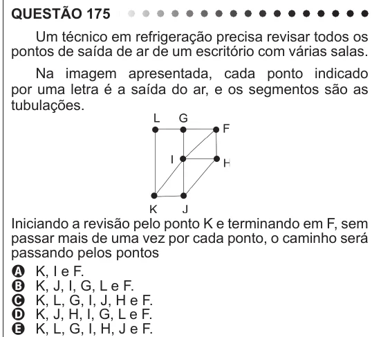

Texto extraído (pode conter ruído)

QUESTÃO 175  
Um técnico em refrigeração precisa revisar todos os  
pontos de saída de ar de um escritório com várias salas.  
Na imagem apresentada, cada ponto indicado  
por uma letra é a saída do ar, e os segmentos são as  
tubulações.  
Iniciando a revisão pelo ponto K e terminando em F, sem  
passar mais de uma vez por cada ponto, o caminho será  
passando pelos pontos  
A K, I e F.  
B K, J, I, G, L e F.  
C K, L, G, I, J, H e F.  
D K, J, H, I, G, L e F.  
E K, L, G, I, H, J e F.

