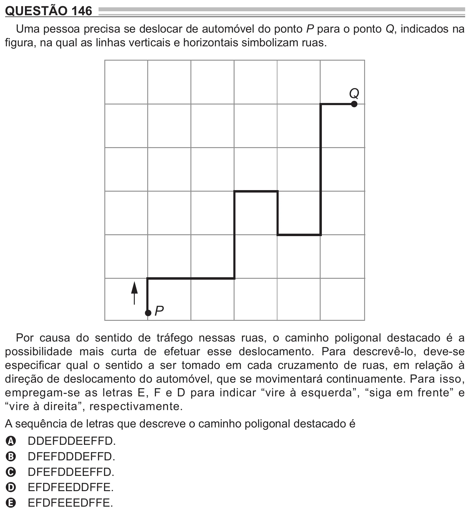

Texto extraído (pode conter ruído)

QUESTÃO 146  
Uma pessoa precisa se deslocar de automóvel do ponto P para o ponto Q, indicados na  
figura, na qual as linhas verticais e horizontais simbolizam ruas.  
Q  
P  
Por causa do sentido de tráfego nessas ruas, o caminho poligonal destacado é a  
possibilidade mais curta de efetuar esse deslocamento. Para descrevê-lo, deve-se  
especificar qual o sentido a ser tomado em cada cruzamento de ruas, em relação à  
direção de deslocamento do automóvel, que se movimentará continuamente. Para isso,  
empregam-se as letras E, F e D para indicar “vire à esquerda”, “siga em frente” e  
“vire à direita”, respectivamente.  
A sequência de letras que descreve o caminho poligonal destacado é  
DDEFDDEEFFD.  
A  
DFEFDDDEFFD.  
B  
DFEFDDEEFFD.  
C  
EFDFEEDDFFE.  
D  
EFDFEEEDFFE.  
E

