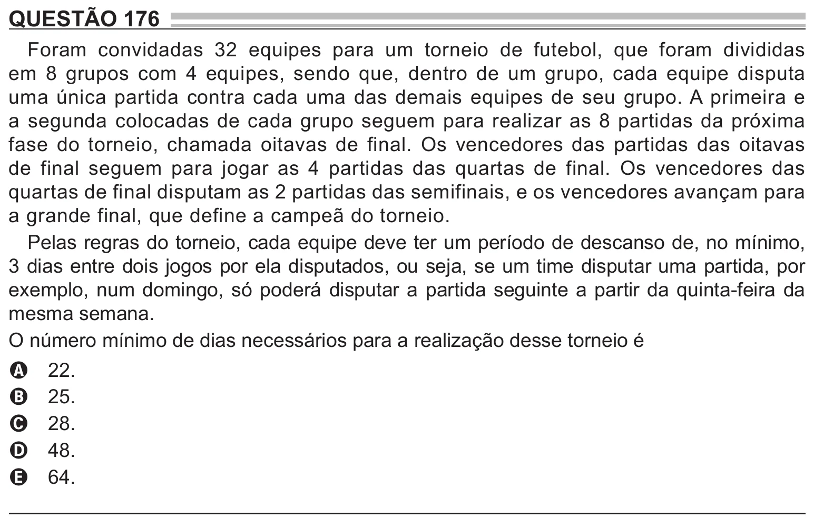

Texto extraído (pode conter ruído)

QUESTÃO 176  
Foram convidadas 32 equipes para um torneio de futebol, que foram divididas  
em 8 grupos com 4 equipes, sendo que, dentro de um grupo, cada equipe disputa  
uma única partida contra cada uma das demais equipes de seu grupo. A primeira e  
a segunda colocadas de cada grupo seguem para realizar as 8 partidas da próxima  
fase do torneio, chamada oitavas de final. Os vencedores das partidas das oitavas  
de final seguem para jogar as 4 partidas das quartas de final. Os vencedores das  
quartas de final disputam as 2 partidas das semifinais, e os vencedores avançam para  
a grande final, que define a campeã do torneio.  
Pelas regras do torneio, cada equipe deve ter um período de descanso de, no mínimo,  
3 dias entre dois jogos por ela disputados, ou seja, se um time disputar uma partida, por  
exemplo, num domingo, só poderá disputar a partida seguinte a partir da quinta-feira da  
mesma semana.  
O número mínimo de dias necessários para a realização desse torneio é  
22.  
A  
25.  
B  
28.  
C  
48.  
D  
64.  
E

