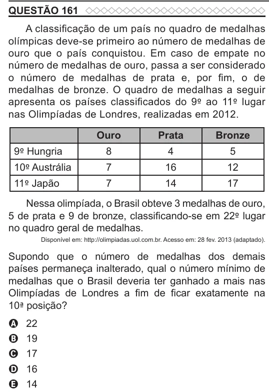

Texto extraído (pode conter ruído)

QUESTÃO 161  
A classificação de um país no quadro de medalhas  
olímpicas deve-se primeiro ao número de medalhas de  
ouro que o país conquistou. Em caso de empate no  
número de medalhas de ouro, passa a ser considerado  
o número de medalhas de prata e, por fim, o de  
medalhas de bronze. O quadro de medalhas a seguir  
apresenta os países classificados do 9º ao 11º lugar  
nas Olimpíadas de Londres, realizadas em 2012.  
Ouro  
Prata  
Bronze  
9º Hungria  
8  
4  
5  
10º Austrália  
7  
16  
12  
11º Japão  
7  
14  
17  
Nessa olimpíada, o Brasil obteve 3 medalhas de ouro,  
5 de prata e 9 de bronze, classificando-se em 22º lugar  
no quadro geral de medalhas.  
Disponível em: http://olimpiadas.uol.com.br. Acesso em: 28 fev. 2013 (adaptado).  
Supondo que o número de medalhas dos demais  
países permaneça inalterado, qual o número mínimo de  
medalhas que o Brasil deveria ter ganhado a mais nas  
Olimpíadas de Londres a fim de ficar exatamente na  
10ª posição?  
A  
22  
19  
B  
17  
C  
16  
D  
14  
E

