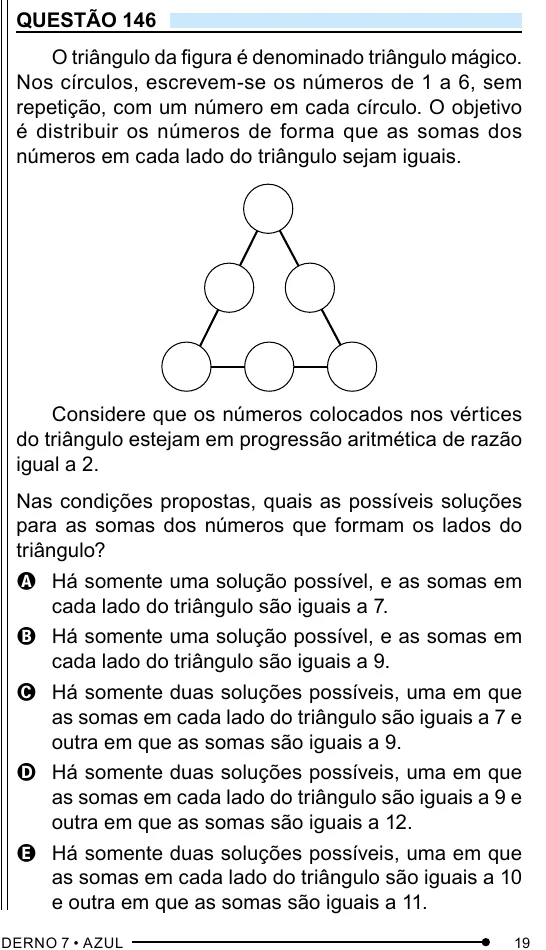

Texto extraído (pode conter ruído)

QUESTÃO 146  
O triângulo da figura é denominado triângulo mágico.  
Nos círculos, escrevem-se os números de 1 a 6, sem  
repetição, com um número em cada círculo. O objetivo  
é distribuir os números de forma que as somas dos  
números em cada lado do triângulo sejam iguais.  
Considere que os números colocados nos vértices  
do triângulo estejam em progressão aritmética de razão  
igual a 2.  
Nas condições propostas, quais as possíveis soluções  
para as somas dos números que formam os lados do  
triângulo?  
A Há somente uma solução possível, e as somas em  
cada lado do triângulo são iguais a 7.  
B Há somente uma solução possível, e as somas em  
cada lado do triângulo são iguais a 9.  
C Há somente duas soluções possíveis, uma em que  
as somas em cada lado do triângulo são iguais a 7 e  
outra em que as somas são iguais a 9.  
D Há somente duas soluções possíveis, uma em que  
as somas em cada lado do triângulo são iguais a 9 e  
outra em que as somas são iguais a 12.  
E Há somente duas soluções possíveis, uma em que  
as somas em cada lado do triângulo são iguais a 10  
e outra em que as somas são iguais a 11.

