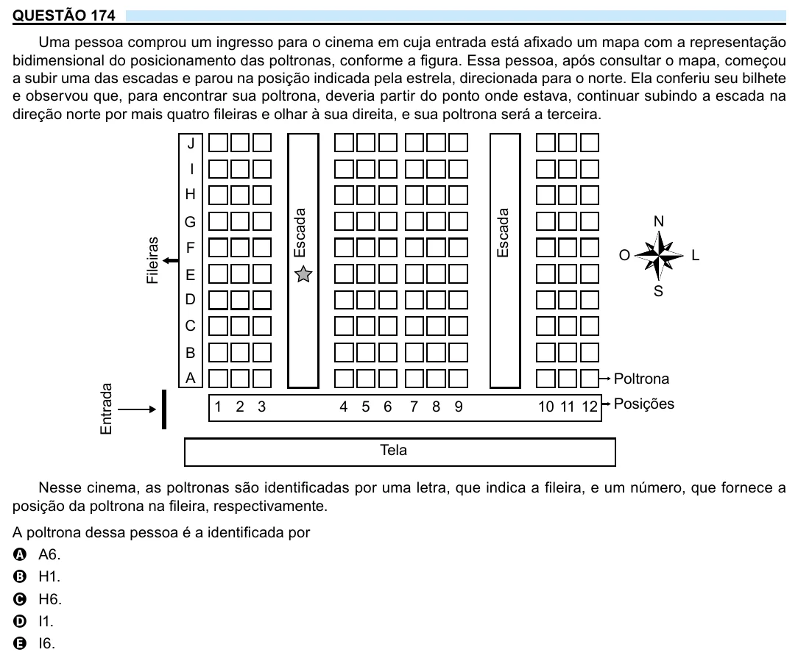

Texto extraído (pode conter ruído)

QUESTÃO 174  
Uma pessoa comprou um ingresso para o cinema em cuja entrada está afixado um mapa com a representação  
bidimensional do posicionamento das poltronas, conforme a figura. Essa pessoa, após consultar o mapa, começou  
a subir uma das escadas e parou na posição indicada pela estrela, direcionada para o norte. Ela conferiu seu bilhete  
e observou que, para encontrar sua poltrona, deveria partir do ponto onde estava, continuar subindo a escada na  
direção norte por mais quatro fileiras e olhar à sua direita, e sua poltrona será a terceira.  
J  
I  
H  
Escada  
Escada  
N  
G  
Fileiras  
F  
O  
L  
E  
S  
D  
C  
B  
A  
Poltrona  
Entrada  
Posições  
1 2 3  
4 5 6  
7 8 9  
10 11 12  
Tela  
Nesse cinema, as poltronas são identificadas por uma letra, que indica a fileira, e um número, que fornece a  
posição da poltrona na fileira, respectivamente.  
A poltrona dessa pessoa é a identificada por  
A A6.  
B H1.  
C H6.  
D I1.  
E I6.

