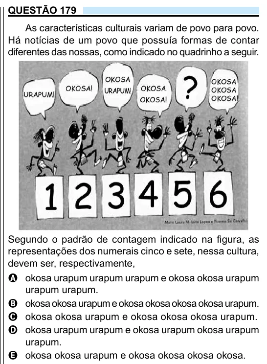

Texto extraído (pode conter ruído)

QUESTÃO 179  
As características culturais variam de povo para povo.  
Há notícias de um povo que possuía formas de contar  
diferentes das nossas, como indicado no quadrinho a seguir.  
Segundo o padrão de contagem indicado na figura, as  
representações dos numerais cinco e sete, nessa cultura,  
devem ser, respectivamente,  
A okosa urapum urapum urapum e okosa okosa urapum  
urapum urapum.  
B okosa okosa urapum e okosa okosa okosa okosa urapum.  
C okosa okosa urapum e okosa okosa okosa urapum.  
D okosa urapum urapum e okosa urapum okosa urapum  
urapum.  
E okosa okosa urapum e okosa okosa okosa okosa.

