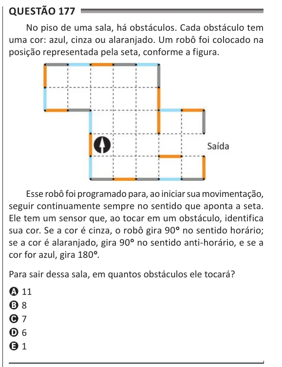

Texto extraído (pode conter ruído)

Questão 177  
No piso de uma sala, há obstáculos. Cada obstáculo tem  
uma cor: azul, cinza ou alaranjado. Um robô foi colocado na  
posição representada pela seta, conforme a figura.  
Esse robô foi programado para, ao iniciar sua movimentação,  
seguir continuamente sempre no sentido que aponta a seta.  
Ele tem um sensor que, ao tocar em um obstáculo, identifica  
sua cor. Se a cor é cinza, o robô gira 90°° no sentido horário;  
se a cor é alaranjado, gira 90°° no sentido anti-horário, e se a  
cor for azul, gira 180°° .  
Para sair dessa sala, em quantos obstáculos ele tocará?  
A 11  
B 8  
C 7  
D 6  
E 1

