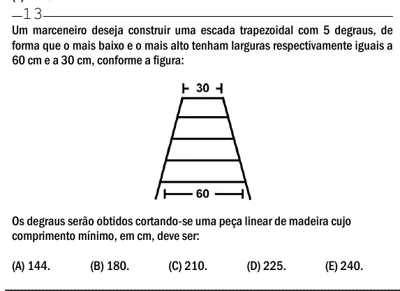

Texto extraído (pode conter ruído)

13  
Um marceneiro deseja construir uma escada trapezoidal com 5 degraus, de  
forma que o mais baixo e o mais alto tenham larguras respectivamente iguais a  
60 cm e a 30 cm, conforme a figura:  
Os degraus serão obtidos cortando-se uma peça linear de madeira cujo  
comprimento mínimo, em cm, deve ser:  
(A) 144.  
(B) 180.  
(C) 210.  
(D) 225.  
(E) 240.

