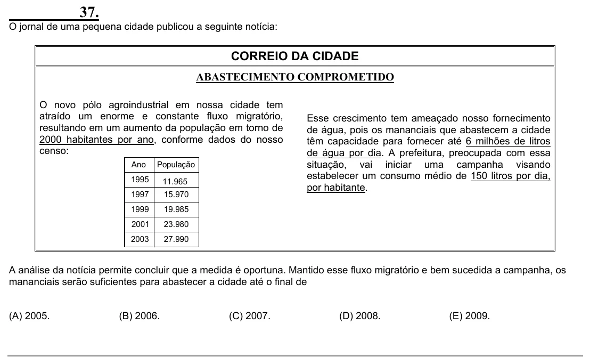

Texto extraído (pode conter ruído)

37.  
O jornal de uma pequena cidade publicou a seguinte notícia:  
CORREIO DA CIDADE  
ABASTECIMENTO COMPROMETIDO  
O novo pólo agroindustrial em nossa cidade tem  
atraído um enorme e constante fluxo migratório,  
Esse crescimento tem ameaçado nosso fornecimento  
resultando em um aumento da população em torno de  
de água, pois os mananciais que abastecem a cidade  
2000 habitantes por ano, conforme dados do nosso  
têm capacidade para fornecer até 6 milhões de litros  
censo:  
de água por dia. A prefeitura, preocupada com essa  
Ano  
População  
situação, vai iniciar uma campanha visando  
estabelecer um consumo médio de 150 litros por dia,  
1995  
11.965  
por habitante.  
1997  
15.970  
19.985  
1999  
2001  
23.980  
2003  
27.990  
A análise da notícia permite concluir que a medida é oportuna. Mantido esse fluxo migratório e bem sucedida a campanha, os  
mananciais serão suficientes para abastecer a cidade até o final de  
(A) 2005.  
(B) 2006.  
(C) 2007.  
(D) 2008.  
(E) 2009.

