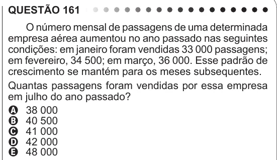

Texto extraído (pode conter ruído)

QUESTÃO 161  
O número mensal de passagens de uma determinada  
empresa aérea aumentou no ano passado nas seguintes  
condições: em janeiro foram vendidas 33 000 passagens;  
em fevereiro, 34 500; em março, 36 000. Esse padrão de  
crescimento se mantém para os meses subsequentes.  
Quantas passagens foram vendidas por essa empresa  
em julho do ano passado?  
A 38 000  
B 40 500  
C 41 000  
D 42 000  
E 48 000

