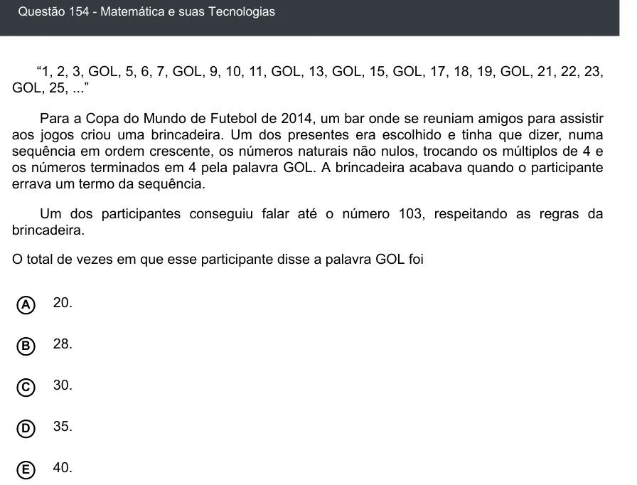

Texto extraído (pode conter ruído)

Questão 154 - Matemática e suas Tecnologias  
“1, 2, 3, GOL, 5, 6, 7, GOL, 9, 10, 11, GOL, 13, GOL, 15, GOL, 17, 18, 19, GOL, 21, 22, 23,  
GOL, 25, ...”  
Para a Copa do Mundo de Futebol de 2014, um bar onde se reuniam amigos para assistir  
aos jogos criou uma brincadeira. Um dos presentes era escolhido e tinha que dizer, numa  
sequência em ordem crescente, os números naturais não nulos, trocando os múltiplos de 4 e  
os números terminados em 4 pela palavra GOL. A brincadeira acabava quando o participante  
errava um termo da sequência.  
Um dos participantes conseguiu falar até o número 103, respeitando as regras da  
brincadeira.  
O total de vezes em que esse participante disse a palavra GOL foi  
20.  
A  
B  
28.  
30.  
C  
35.  
D  
E  
40.

