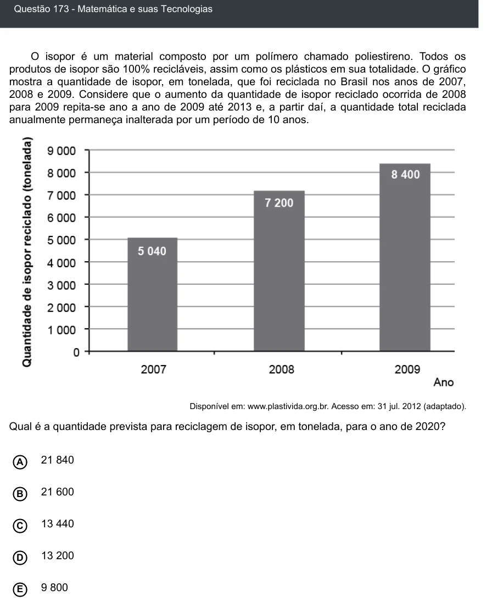

Texto extraído (pode conter ruído)

Questão 173 - Matemática e suas Tecnologias  
O isopor é um material composto por um polímero chamado poliestireno. Todos os  
produtos de isopor são 100% recicláveis, assim como os plásticos em sua totalidade. O gráfico  
mostra a quantidade de isopor, em tonelada, que foi reciclada no Brasil nos anos de 2007,  
2008 e 2009. Considere que o aumento da quantidade de isopor reciclado ocorrida de 2008  
para 2009 repita-se ano a ano de 2009 até 2013 e, a partir daí, a quantidade total reciclada  
anualmente permaneça inalterada por um período de 10 anos.  
Disponível em: www.plastivida.org.br. Acesso em: 31 jul. 2012 (adaptado).  
Qual é a quantidade prevista para reciclagem de isopor, em tonelada, para o ano de 2020?  
21 840  
A  
B  
21 600  
13 440  
C  
13 200  
D  
9 800  
E

