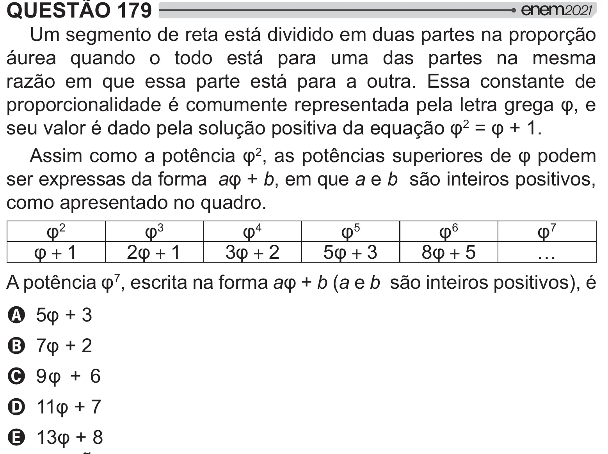

Texto extraído (pode conter ruído)

QUESTÃO 179  
Um segmento de reta está dividido em duas partes na proporção  
áurea quando o todo está para uma das partes na mesma  
razão em que essa parte está para a outra. Essa constante de  
## <    #  
 #   Ê   
"<#   =[#  "  
=[Ê 2 §Ê²`!  
 # +Ê 2  # +  #   Ê#   
ser expressas da forma aʲb, em que a e b são inteiros positivos,  
como apresentado no quadro.  
Ê 2  
Ê 3  
Ê 4  
Ê 5  
Ê 6  
Ê 7  
Ê + 1  
2Ê + 1  
3Ê + 2  
5Ê + 3  
8Ê + 5  
…  
# +Ê 7 , escrita na forma aʲb (a e b são inteiros positivos), é  
A ʲ®  
B Äʲ‘  
C ¨Ê²©  
D ``Ê²Ä  
E `®Ê²£

