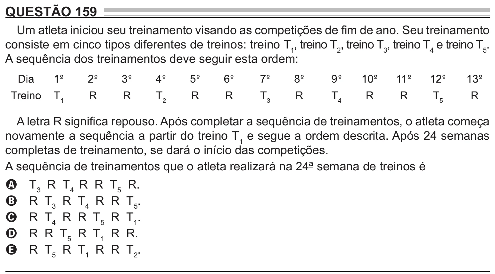

Texto extraído (pode conter ruído)

QUESTÃO 159  
Um atleta iniciou seu treinamento visando as competições de fim de ano. Seu treinamento  
consiste em cinco tipos diferentes de treinos: treino T 1 , treino T 2 , treino T 3 , treino T 4 e treino T 5 .  
A sequência dos treinamentos deve seguir esta ordem:  
A letra R significa repouso. Após completar a sequência de treinamentos, o atleta começa  
novamente a sequência a partir do treino T 1 e segue a ordem descrita. Após 24 semanas  
completas de treinamento, se dará o início das competições.  
A sequência de treinamentos que o atleta realizará na 24ª semana de treinos é  
T 3 R T 4 R R T 5 R.  
A  
R T 3 R T 4 R R T 5 .  
B  
R T 4 R R T 5 R T 1 .  
C  
R R T 5 R T 1 R R.  
D  
R T 5 R T 1 R R T 2 .  
E

