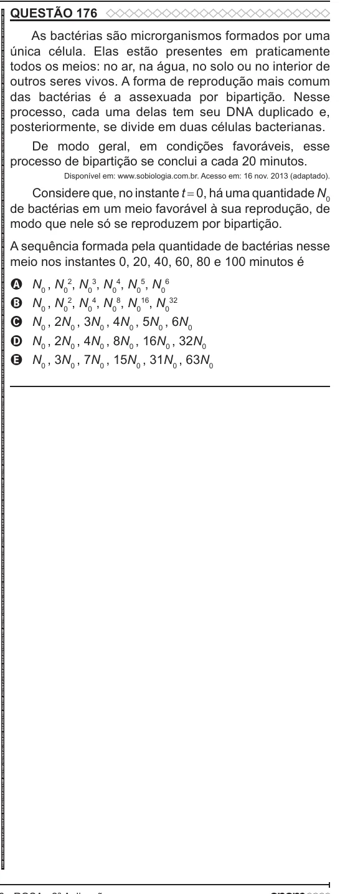

Texto extraído (pode conter ruído)

QUESTÃO 176  
ENEM 2022 ENEM 2022 ENEM 2022 ENEM 2022 ENEM 2022 ENEM 2022 ENEM 2022 ENEM 2022 ENEM 2022 ENEM 2022 ENEM 2022 ENEM 2022 ENEM 2022 ENEM 2022 ENEM 2022 ENEM 2022 ENEM 2022 ENEM 2022 ENEM 2022 ENEM 2022 ENEM 2022 ENEM 2022 ENEM 2022 ENEM 2022 ENEM 2022 ENEM 2022 ENEM 2022 ENEM 2022 ENEM 2022 ENEM 2022 ENEM 2022 ENEM 2022 ENEM 2022 ENEM 2022 ENEM 2022 ENEM 2022 ENEM 2022 ENEM 2022 ENEM 2022 ENEM 2022 ENEM 2022 ENEM 2022 ENEM 2022 ENEM 2022 ENEM 2022 ENEM 2022 ENEM 2022 ENEM 2022 ENEM 2022 ENEM 2022 ENEM 2022 ENEM 2022 ENEM 2022 ENEM 2022 ENEM 2022 ENEM 2022 ENEM 2022 ENEM 2022 ENEM 2022 ENEM 2022 ENEM 2022 ENEM 2022 ENEM 2022  
As bactérias são microrganismos formados por uma  
única célula. Elas estão presentes em praticamente  
todos os meios: no ar, na água, no solo ou no interior de  
outros seres vivos. A forma de reprodução mais comum  
das bactérias é a assexuada por bipartição. Nesse  
processo, cada uma delas tem seu DNA duplicado e,  
posteriormente, se divide em duas células bacterianas.  
De modo geral, em condições favoráveis, esse  
processo de bipartição se conclui a cada 20 minutos.  
Disponível em: www.sobiologia.com.br. Acesso em: 16 nov. 2013 (adaptado).  
Considere que, no instante t = 0, há uma quantidade N 0  
de bactérias em um meio favorável à sua reprodução, de  
modo que nele só se reproduzem por bipartição.  
A sequência formada pela quantidade de bactérias nesse  
meio nos instantes 0, 20, 40, 60, 80 e 100 minutos é  
N 0 , N 02 , N 03 , N 04 , N 05 , N 06  
A  
N 0 , N 02 , N 04 , N 08 , N 016 , N 032  
B  
N 0 , 2N 0 , 3N 0 , 4N 0 , 5N 0 , 6N 0  
C  
D  
N 0 , 2N 0 , 4N 0 , 8N 0 , 16N 0 , 32N 0  
N 0 , 3N 0 , 7N 0 , 15N 0 , 31N 0 , 63N 0  
E

