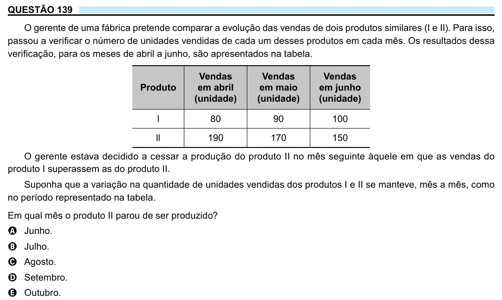

Texto extraído (pode conter ruído)

QUESTÃO 139  
O gerente de uma fábrica pretende comparar a evolução das vendas de dois produtos similares (I e II). Para isso,  
passou a verificar o número de unidades vendidas de cada um desses produtos em cada mês. Os resultados dessa  
verificação, para os meses de abril a junho, são apresentados na tabela.  
Vendas  
Vendas  
Vendas  
Produto  
em abril  
em maio  
em junho  
(unidade)  
(unidade)  
(unidade)  
l  
80  
90  
100  
ll  
190  
170  
150  
O gerente estava decidido a cessar a produção do produto II no mês seguinte àquele em que as vendas do  
produto I superassem as do produto II.  
Suponha que a variação na quantidade de unidades vendidas dos produtos I e II se manteve, mês a mês, como  
no período representado na tabela.  
Em qual mês o produto II parou de ser produzido?  
A Junho.  
B Julho.  
C Agosto.  
D Setembro.  
E Outubro.

