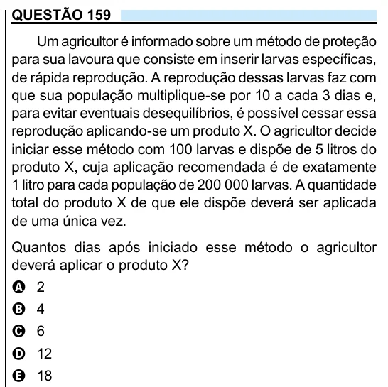

Texto extraído (pode conter ruído)

QUESTÃO 159  
Um agricultor é informado sobre um método de proteção  
para sua lavoura que consiste em inserir larvas específicas,  
de rápida reprodução. A reprodução dessas larvas faz com  
que sua população multiplique-se por 10 a cada 3 dias e,  
para evitar eventuais desequilíbrios, é possível cessar essa  
reprodução aplicando-se um produto X. O agricultor decide  
iniciar esse método com 100 larvas e dispõe de 5 litros do  
produto X, cuja aplicação recomendada é de exatamente  
1 litro para cada população de 200 000 larvas. A quantidade  
total do produto X de que ele dispõe deverá ser aplicada  
de uma única vez.  
Quantos dias após iniciado esse método o agricultor  
deverá aplicar o produto X?  
A 2  
B 4  
C 6  
D 12  
E 18

