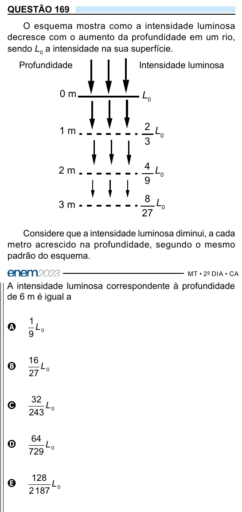

Texto extraído (pode conter ruído)

QUESTÃO 169  
O esquema mostra como a intensidade luminosa  
decresce com o aumento da profundidade em um rio,  
sendo L 0 a intensidade na sua superfície.  
Profundidade  
Intensidade luminosa  
0 m  
L 0  
2 L  
1 m  
0  
3  
4 L  
2 m  
0  
9  
8 L  
3 m  
0  
27  
Considere que a intensidade luminosa diminui, a cada  
metro acrescido na profundidade, segundo o mesmo  
padrão do esquema.  
A intensidade luminosa correspondente à profundidade  
de 6 m é igual a  
1  
A  
L 0  
9  
16  
B  
L 0  
27  
32  
C  
L 0  
243  
64  
D  
L 0  
729  
128  
E  
L 0  
2 187

