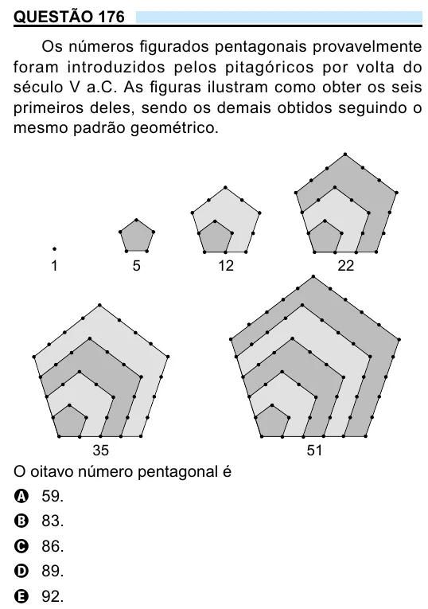

Texto extraído (pode conter ruído)

QUESTÃO 176  
Os números figurados pentagonais provavelmente  
foram introduzidos pelos pitagóricos por volta do  
século V a.C. As figuras ilustram como obter os seis  
primeiros deles, sendo os demais obtidos seguindo o  
mesmo padrão geométrico.  
1  
5  
12  
22  
35  
51  
O oitavo número pentagonal é  
A 59.  
B 83.  
C 86.  
D 89.  
E 92.

