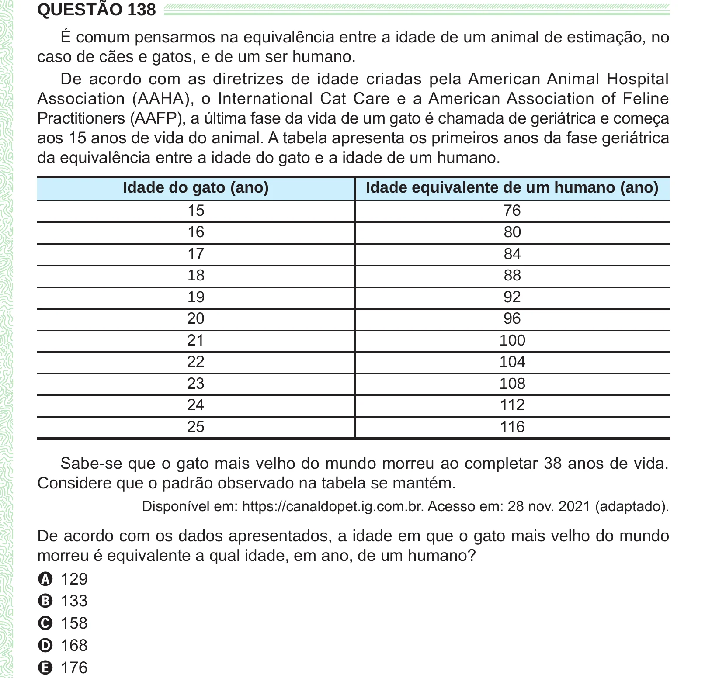

Texto extraído (pode conter ruído)

QUESTÃO 138  
É comum pensarmos na equivalência entre a idade de um animal de estimação, no  
caso de cães e gatos, e de um ser humano.  
De acordo com as diretrizes de idade criadas pela American Animal Hospital  
Association (AAHA), o International Cat Care e a American Association of Feline  
Practitioners (AAFP), a última fase da vida de um gato é chamada de geriátrica e começa  
aos 15 anos de vida do animal. A tabela apresenta os primeiros anos da fase geriátrica  
da equivalência entre a idade do gato e a idade de um humano.  
Idade do gato (ano)  
Idade equivalente de um humano (ano)  
15  
76  
16  
80  
17  
84  
18  
88  
92  
19  
20  
96  
21  
100  
22  
104  
23  
108  
24  
112  
25  
116  
Sabe-se que o gato mais velho do mundo morreu ao completar 38 anos de vida.  
Considere que o padrão observado na tabela se mantém.  
Disponível em: https://canaldopet.ig.com.br. Acesso em: 28 nov. 2021 (adaptado).  
De acordo com os dados apresentados, a idade em que o gato mais velho do mundo  
morreu é equivalente a qual idade, em ano, de um humano?  
A 129  
B 133  
C 158  
D 168  
E 176

