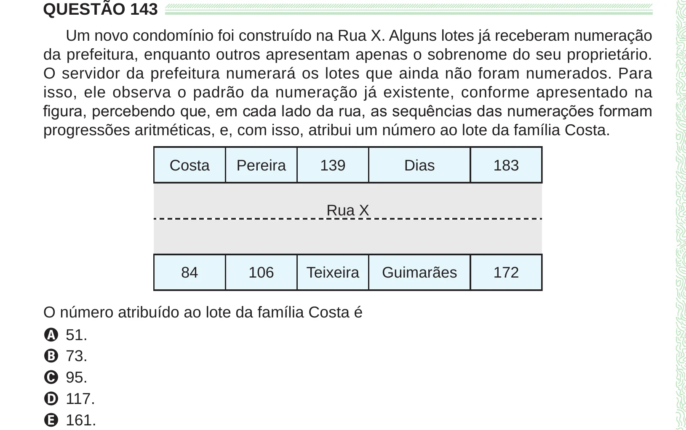

Texto extraído (pode conter ruído)

QUESTÃO 143  
Um novo condomínio foi construído na Rua X. Alguns lotes já receberam numeração  
da prefeitura, enquanto outros apresentam apenas o sobrenome do seu proprietário.  
O servidor da prefeitura numerará os lotes que ainda não foram numerados. Para  
isso, ele observa o padrão da numeração já existente, conforme apresentado na  
figura, percebendo que, em cada lado da rua, as sequências das numerações formam  
progressões aritméticas, e, com isso, atribui um número ao lote da família Costa.  
Costa  
Pereira  
139  
Dias  
183  
Rua X  
84  
106  
Teixeira  
Guimarães  
172  
O número atribuído ao lote da família Costa é  
A 51.  
B 73.  
C 95.  
D 117.  
E 161.

