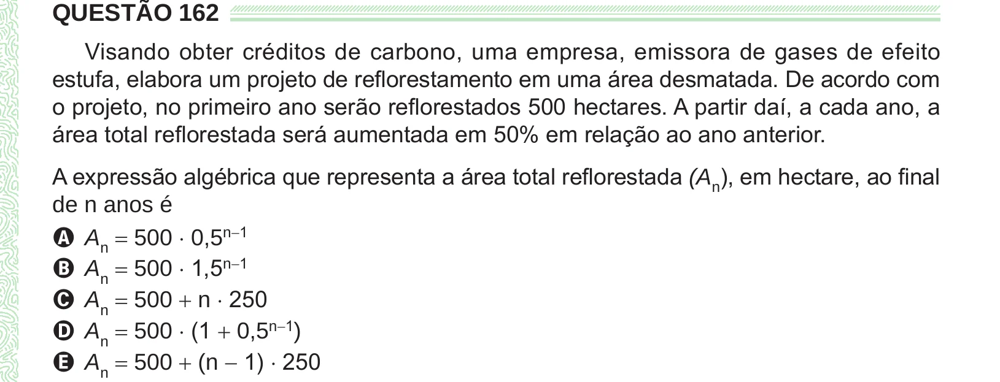

Texto extraído (pode conter ruído)

QUESTÃO 162  
Visando obter créditos de carbono, uma empresa, emissora de gases de efeito  
estufa, elabora um projeto de reflorestamento em uma área desmatada. De acordo com  
o projeto, no primeiro ano serão reflorestados 500 hectares. A partir daí, a cada ano, a  
área total reflorestada será aumentada em 50% em relação ao ano anterior.  
A expressão algébrica que representa a área total reflorestada (A n ), em hectare, ao final  
de n anos é  
A A n = 500 ⋅ 0,5 n−1  
B A n = 500 ⋅ 1,5 n−1  
C A n = 500 + n ⋅ 250  
D A n = 500 ⋅ (1 + 0,5 n−1 )  
E A n = 500 + (n − 1) ⋅ 250

