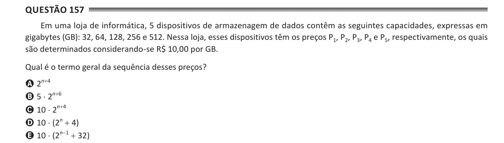

Texto extraído (pode conter ruído)

Questão 157  
Em uma loja de informática, 5 dispositivos de armazenagem de dados contêm as seguintes capacidades, expressas em  
gigabytes (GB): 32, 64, 128, 256 e 512. Nessa loja, esses dispositivos têm os preços P 1 , P 2 , P 3 , P 4 e P 5 , respectivamente, os quais  
são determinados considerando-se R$ 10,00 por GB.  
Qual é o termo geral da sequência desses preços?  
A 2 n+4  
B 5 ⋅ 2 n+6  
C 10 ⋅ 2 n+4  
D 10 ⋅ (2 n + 4)  
E 10 ⋅ (2 n-1 + 32)

