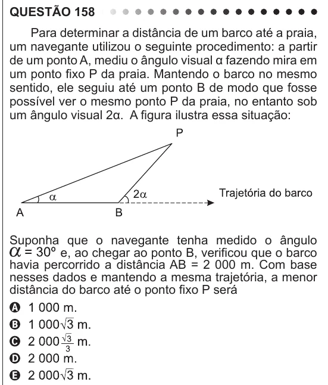

Texto extraído (pode conter ruído)

QUESTÃO 158  
Para determinar a distância de um barco até a praia,  
um navegante utilizou o seguinte procedimento: a partir  
de um ponto A, mediu o ângulo visual α fazendo mira em  
um ponto fixo P da praia. Mantendo o barco no mesmo  
sentido, ele seguiu até um ponto B de modo que fosse  
possível ver o mesmo ponto P da praia, no entanto sob  
um ângulo visual 2α. A figura ilustra essa situação:  
Suponha que o navegante tenha medido o ângulo  
e, ao chegar ao ponto B, verificou que o barco  
havia percorrido a distância AB = 2 000 m. Com base  
nesses dados e mantendo a mesma trajetória, a menor  
distância do barco até o ponto fixo P será

