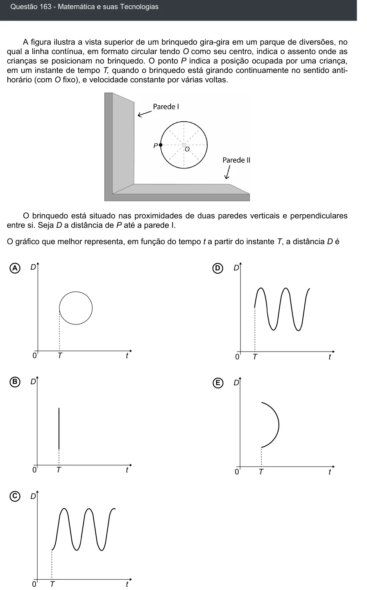

Texto extraído (pode conter ruído)

Questão 163 - Matemática e suas Tecnologias  
A figura ilustra a vista superior de um brinquedo gira-gira em um parque de diversões, no  
qual a linha contínua, em formato circular tendo O como seu centro, indica o assento onde as  
crianças se posicionam no brinquedo. O ponto P indica a posição ocupada por uma criança,  
em um instante de tempo T, quando o brinquedo está girando continuamente no sentido anti-  
horário (com O fixo), e velocidade constante por várias voltas.  
O brinquedo está situado nas proximidades de duas paredes verticais e perpendiculares  
entre si. Seja D a distância de P até a parede I.  
O gráfico que melhor representa, em função do tempo t a partir do instante T, a distância D é  
A  
D  
B  
E  
C

