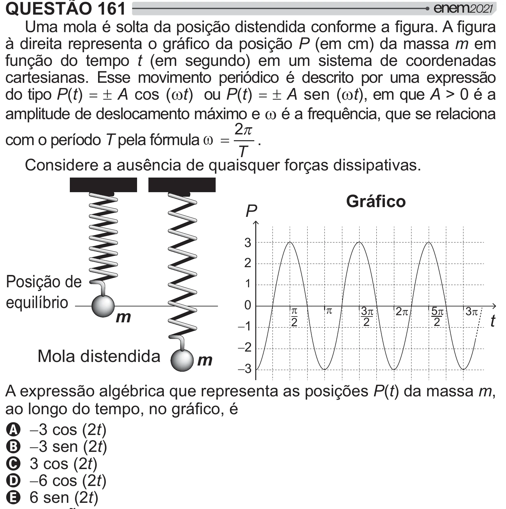

Texto extraído (pode conter ruído)

QUESTÃO 161  
'<  # =[ >  !   
¸   #  
 /# =[P (em cm) da massa m em  
função do tempo t (em segundo) em um sistema de coordenadas  
cartesianas. Esse movimento periódico é descrito por uma expressão  
do tipo P(t) = rA cos ( Z t) ou P(t) = rA sen ( Z t), em que A > 0 é a  
amplitude de deslocamento máximo e Z é a frequência, que se relaciona  
2  
Z  
com o período T pela fórmula  
.  
T  
Considere a ausência de quaisquer forças dissipativas.  
Gráfico  
P  
3  
2  
Posição de  
1  
equilíbrio  
0  
S  
S  
m  
3S  
2S  
5S  
3S  
t  
2  
2  
2  
1  
2  
Mola distendida  
m  
3  
A expressão algébrica que representa as posições P(t) da massa m,  
 #/<  
A 3 cos (2t)  
B 3 sen (2t)  
C 3 cos (2t)  
D 6 cos (2t)  
E 6 sen (2t)

