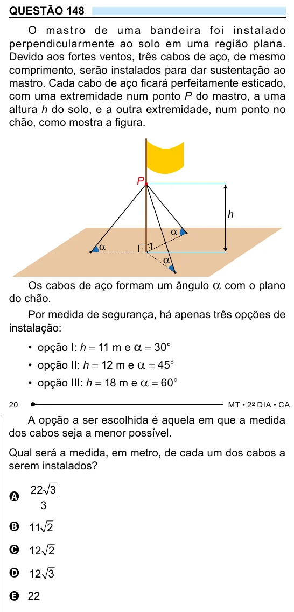

Texto extraído (pode conter ruído)

QUESTÃO 148  
O m ast r o d e um a ban d e i r a fo i inst a lad o  
perpendicularmente ao solo em uma região plana.  
Devido aos fortes ventos, três cabos de aço, de mesmo  
comprimento, serão instalados para dar sustentação ao  
mastro. Cada cabo de aço ficará perfeitamente esticado,  
com uma extremidade num ponto P do mastro, a uma  
altura h do solo, e a outra extremidade, num ponto no  
chão, como mostra a figura.  
P  
h  
α  
α  
α  
Os cabos de aço formam um ângulo a com o plano  
do chão.  
Por medida de segurança, há apenas três opções de  
instalação:  
• opção I: h = 11 m e a = 30°  
• opção II: h = 12 m e a = 45°  
• opção III: h = 18 m e a = 60°  
A opção a ser escolhida é aquela em que a medida  
dos cabos seja a menor possível.  
Qual será a medida, em metro, de cada um dos cabos a  
serem instalados?  
22 3  
A  
3  
B 11 2  
C 12 2  
D 12 3  
E 22

