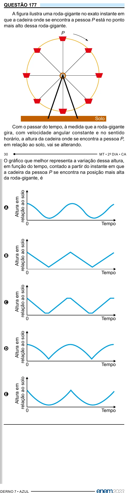

Texto extraído (pode conter ruído)

QUESTÃO 177  
A figura ilustra uma roda-gigante no exato instante em  
que a cadeira onde se encontra a pessoa P está no ponto  
mais alto dessa roda-gigante.  
P  
Solo  
Com o passar do tempo, à medida que a roda-gigante  
gira, com velocidade angular constante e no sentido  
horário, a altura da cadeira onde se encontra a pessoa P,  
em relação ao solo, vai se alterando.  
O gráfico que melhor representa a variação dessa altura,  
em função do tempo, contado a partir do instante em que  
a cadeira da pessoa P se encontra na posição mais alta  
da roda-gigante, é  
relação ao solo  
Altura em  
A  
0  
Tempo  
relação ao solo  
Altura em  
B  
0  
Tempo  
relação ao solo  
Altura em  
C  
0  
Tempo  
relação ao solo  
Altura em  
D  
0  
Tempo  
relação ao solo  
Altura em  
E  
0  
Tempo

