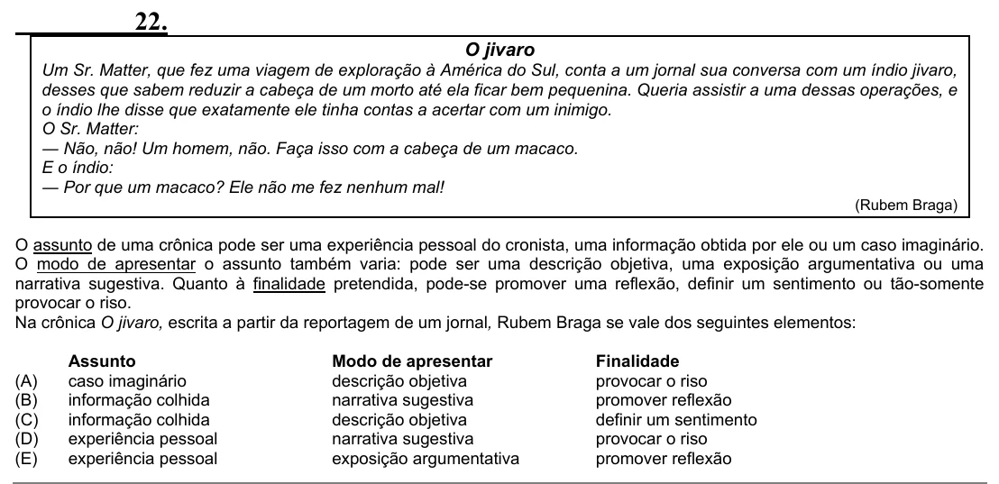

Texto extraído (pode conter ruído)

22.  
O jivaro  
Um Sr. Matter, que fez uma viagem de exploração à América do Sul, conta a um jornal sua conversa com um índio jivaro,  
desses que sabem reduzir a cabeça de um morto até ela ficar bem pequenina. Queria assistir a uma dessas operações, e  
o índio lhe disse que exatamente ele tinha contas a acertar com um inimigo.  
O Sr. Matter:  
― Não, não! Um homem, não. Faça isso com a cabeça de um macaco.  
E o índio:  
― Por que um macaco? Ele não me fez nenhum mal!  
(Rubem Braga)  
O assunto de uma crônica pode ser uma experiência pessoal do cronista, uma informação obtida por ele ou um caso imaginário.  
O modo de apresentar o assunto também varia: pode ser uma descrição objetiva, uma exposição argumentativa ou uma  
narrativa sugestiva. Quanto à finalidade pretendida, pode-se promover uma reflexão, definir um sentimento ou tão-somente  
provocar o riso.  
Na crônica O jivaro, escrita a partir da reportagem de um jornal, Rubem Braga se vale dos seguintes elementos:  
Assunto  
Modo de apresentar  
Finalidade  
(A)  
caso imaginário  
descrição objetiva  
provocar o riso  
(B)  
informação colhida  
narrativa sugestiva  
promover reflexão  
(C)  
informação colhida  
descrição objetiva  
definir um sentimento  
(D)  
experiência pessoal  
narrativa sugestiva  
provocar o riso  
(E)  
experiência pessoal  
exposição argumentativa  
promover reflexão

