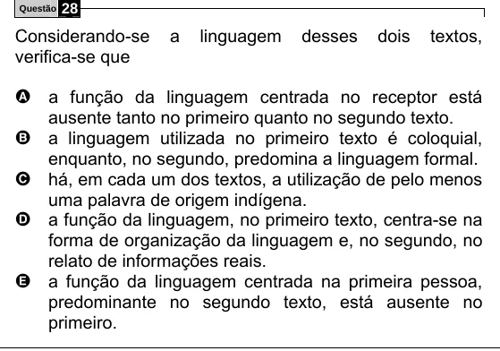

Texto extraído (pode conter ruído)

Questão  
28  
Considerando-se  
a  
linguagem  
desses  
dois  
textos,  
verifica-se que  
A a função da linguagem centrada no receptor está  
ausente tanto no primeiro quanto no segundo texto.  
B a linguagem utilizada no primeiro texto é coloquial,  
enquanto, no segundo, predomina a linguagem formal.  
C há, em cada um dos textos, a utilização de pelo menos  
uma palavra de origem indígena.  
D a função da linguagem, no primeiro texto, centra-se na  
forma de organização da linguagem e, no segundo, no  
relato de informações reais.  
E a função da linguagem centrada na primeira pessoa,  
predominante no segundo texto, está ausente no  
primeiro.

