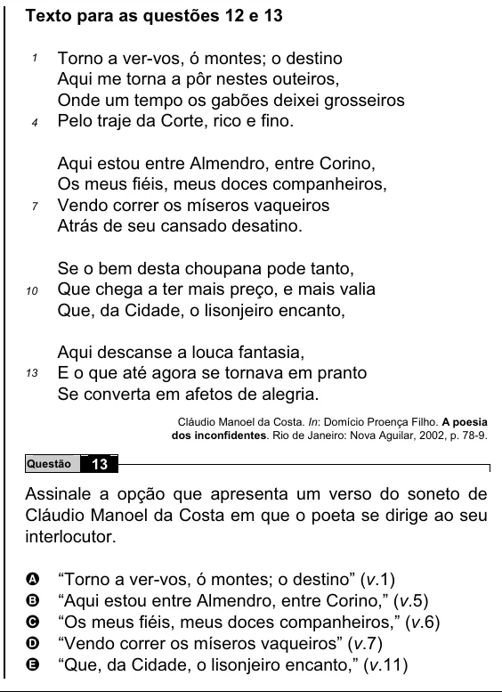

Texto extraído (pode conter ruído)

Texto para as questões 12 e 13  
Torno a ver-vos, ó montes; o destino  
1  
Aqui me torna a pôr nestes outeiros,  
Onde um tempo os gabões deixei grosseiros  
Pelo traje da Corte, rico e fino.  
4  
Aqui estou entre Almendro, entre Corino,  
Os meus fiéis, meus doces companheiros,  
Vendo correr os míseros vaqueiros  
7  
Atrás de seu cansado desatino.  
Se o bem desta choupana pode tanto,  
Que chega a ter mais preço, e mais valia  
10  
Que, da Cidade, o lisonjeiro encanto,  
Aqui descanse a louca fantasia,  
E o que até agora se tornava em pranto  
13  
Se converta em afetos de alegria.  
Cláudio Manoel da Costa. In: Domício Proença Filho. A poesia  
dos inconfidentes. Rio de Janeiro: Nova Aguilar, 2002, p. 78-9.  
Questão  
13  
Assinale a opção que apresenta um verso do soneto de  
Cláudio Manoel da Costa em que o poeta se dirige ao seu  
interlocutor.  
“Torno a ver-vos, ó montes; o destino” (v.1)  
A  
“Aqui estou entre Almendro, entre Corino,” (v.5)  
B  
“Os meus fiéis, meus doces companheiros,” (v.6)  
C  
D  
“Vendo correr os míseros vaqueiros” (v.7)  
E  
“Que, da Cidade, o lisonjeiro encanto,” (v.11)

