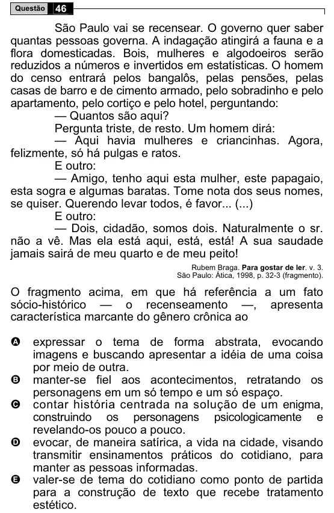

Texto extraído (pode conter ruído)

46  
Questão  
São Paulo vai se recensear. O governo quer saber  
quantas pessoas governa. A indagação atingirá a fauna e a  
flora domesticadas. Bois, mulheres e algodoeiros serão  
reduzidos a números e invertidos em estatísticas. O homem  
do censo entrará pelos bangalôs, pelas pensões, pelas  
casas de barro e de cimento armado, pelo sobradinho e pelo  
apartamento, pelo cortiço e pelo hotel, perguntando:  
— Quantos são aqui?  
Pergunta triste, de resto. Um homem dirá:  
— Aqui havia mulheres e criancinhas. Agora,  
felizmente, só há pulgas e ratos.  
E outro:  
— Amigo, tenho aqui esta mulher, este papagaio,  
esta sogra e algumas baratas. Tome nota dos seus nomes,  
se quiser. Querendo levar todos, é favor... (...)  
E outro:  
— Dois, cidadão, somos dois. Naturalmente o sr.  
não a vê. Mas ela está aqui, está, está! A sua saudade  
jamais sairá de meu quarto e de meu peito!  
Rubem Braga. Para gostar de ler. v. 3.  
São Paulo: Ática, 1998, p. 32-3 (fragmento).  
O fragmento acima, em que há referência a um fato  
sócio-histórico — o recenseamento —, apresenta  
característica marcante do gênero crônica ao  
A  
expressar o tema de forma abstrata, evocando  
imagens e buscando apresentar a idéia de uma coisa  
por meio de outra.  
B  
manter-se fiel aos acontecimentos, retratando os  
personagens em um só tempo e um só espaço.  
contar história centrada na solução de um enigma,  
C  
construindo os personagens psicologicamente e  
revelando-os pouco a pouco.  
evocar, de maneira satírica, a vida na cidade, visando  
D  
transmitir ensinamentos práticos do cotidiano, para  
manter as pessoas informadas.  
valer-se de tema do cotidiano como ponto de partida  
E  
para a construção de texto que recebe tratamento  
estético.

