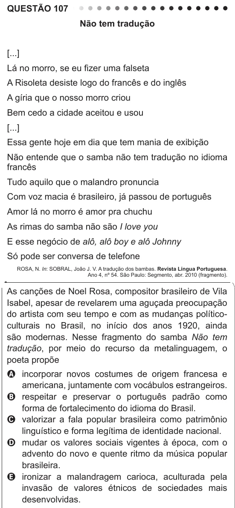

Texto extraído (pode conter ruído)

QUESTÃO 107  
Não tem tradução  
[...]  
Lá no morro, se eu fizer uma falseta  
A Risoleta desiste logo do francês e do inglês  
A gíria que o nosso morro criou  
Bem cedo a cidade aceitou e usou  
[...]  
Essa gente hoje em dia que tem mania de exibição  
Não entende que o samba não tem tradução no idioma  
francês  
Tudo aquilo que o malandro pronuncia  
Com voz macia é brasileiro, já passou de português  
Amor lá no morro é amor pra chuchu  
As rimas do samba não são I love you  
E esse negócio de alô, alô boy e alô Johnny  
Só pode ser conversa de telefone  
ROSA, N. In: SOBRAL, João J. V. A tradução dos bambas. Revista Língua Portuguesa.  
Ano 4, nº 54. São Paulo: Segmento, abr. 2010 (fragmento).  
As canções de Noel Rosa, compositor brasileiro de Vila  
Isabel, apesar de revelarem uma aguçada preocupação  
do artista com seu tempo e com as mudanças político-  
culturais no Brasil, no início dos anos 1920, ainda  
são modernas. Nesse fragmento do samba Não tem  
tradução, por meio do recurso da metalinguagem, o  
poeta propõe  
A incorporar novos costumes de origem francesa e  
americana, juntamente com vocábulos estrangeiros.  
B respeitar e preservar o português padrão como  
forma de fortalecimento do idioma do Brasil.  
C valorizar a fala popular brasileira como patrimônio  
linguístico e forma legítima de identidade nacional.  
D mudar os valores sociais vigentes à época, com o  
advento do novo e quente ritmo da música popular  
brasileira.  
E ironizar a malandragem carioca, aculturada pela  
invasão de valores étnicos de sociedades mais  
desenvolvidas.

