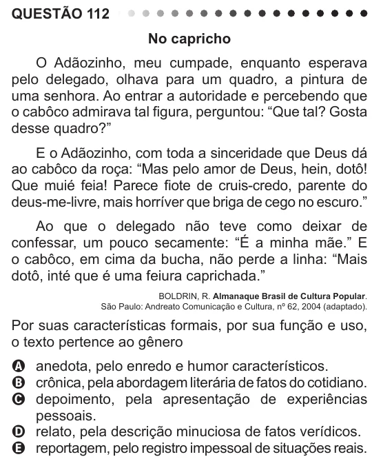

Texto extraído (pode conter ruído)

QUESTÃO 112  
No capricho  
O Adãozinho, meu cumpade, enquanto esperava  
pelo delegado, olhava para um quadro, a pintura de  
uma senhora. Ao entrar a autoridade e percebendo que  
o cabôco admirava tal figura, perguntou: “Que tal? Gosta  
desse quadro?”  
E o Adãozinho, com toda a sinceridade que Deus dá  
ao cabôco da roça: “Mas pelo amor de Deus, hein, dotô!  
Que muié feia! Parece fiote de cruis-credo, parente do  
deus-me-livre, mais horríver que briga de cego no escuro.”  
Ao que o delegado não teve como deixar de  
confessar, um pouco secamente: “É a minha mãe.” E  
o cabôco, em cima da bucha, não perde a linha: “Mais  
dotô, inté que é uma feiura caprichada.”  
BOLDRIN, R. Almanaque Brasil de Cultura Popular.  
São Paulo: Andreato Comunicação e Cultura, nº 62, 2004 (adaptado).  
Por suas características formais, por sua função e uso,  
o texto pertence ao gênero  
A anedota, pelo enredo e humor característicos.  
B crônica, pela abordagem literária de fatos do cotidiano.  
C depoimento, pela apresentação de experiências  
pessoais.  
D relato, pela descrição minuciosa de fatos verídicos.  
E reportagem, pelo registro impessoal de situações reais.

